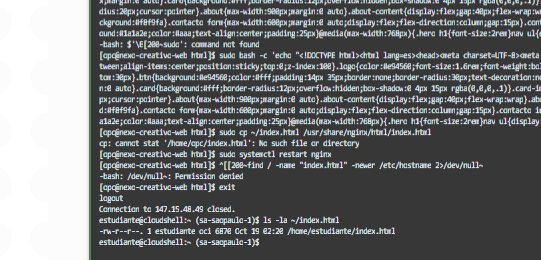
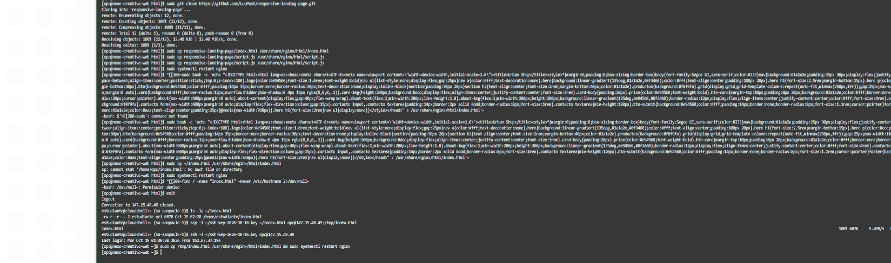
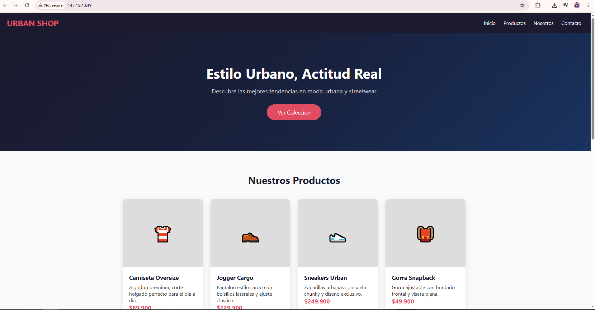
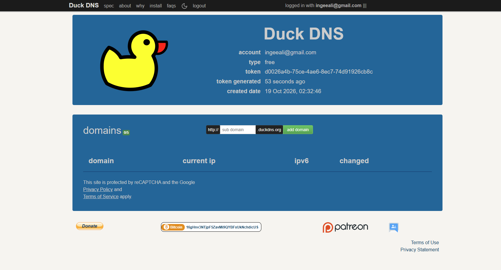
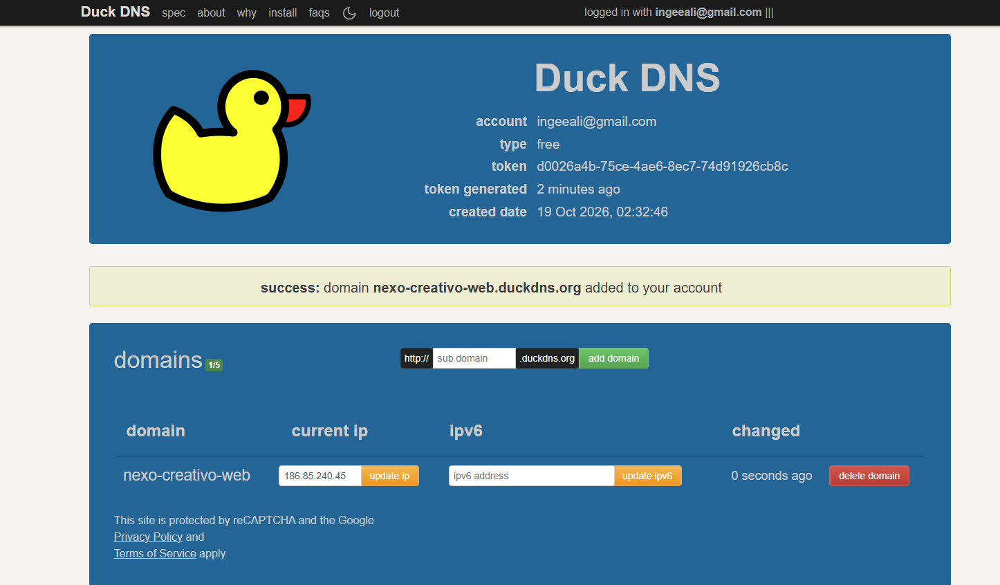
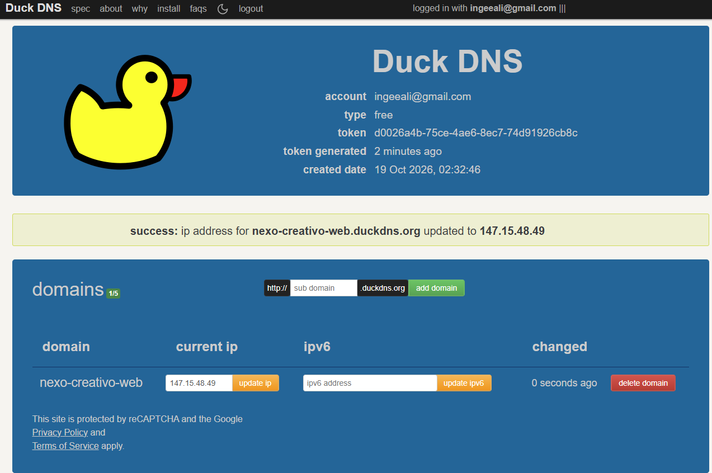
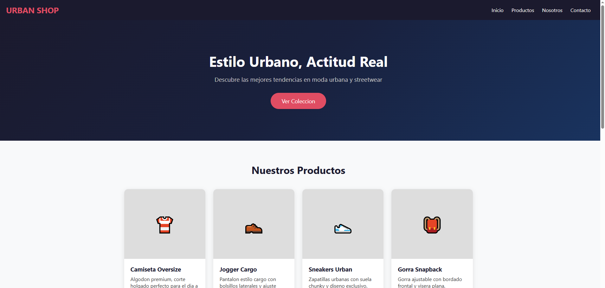

# Taller 1.3 — Publicación Web en OCI con DuckDNS

## Objetivo

Desplegar una página web propia en una instancia de Oracle Cloud Infrastructure (OCI) utilizando el servidor web Nginx, y configurar un subdominio gratuito con DuckDNS para acceder a la página mediante HTTP desde un navegador externo.

**Tiempo estimado:** 90 minutos
**Recursos previos:** Cuenta OCI con Free Tier, VCN configurada del taller inicial, acceso a OCI Cloud Shell.

---

## Datos del despliegue

| Elemento | Valor |
|---|---|
| Instancia | nexo-creativo-web |
| Shape | VM.Standard.E5.Flex |
| IP Pública | 147.15.48.49 |
| Sistema Operativo | Oracle Linux 9 |
| VCN | red-infraestructura |
| Subred | subred-web (Pública, 10.0.0.0/24) |
| Servidor Web | Nginx 1.20.1 |
| Subdominio DuckDNS | nexo-creativo-web.duckdns.org |

---

## Tabla de contenido

- [Fase 1: Crear la instancia en OCI](#fase-1-crear-la-instancia-en-oci)
  - [Paso 1.1: Acceder a la consola de OCI](#paso-11-acceder-a-la-consola-de-oci)
  - [Paso 1.2: Crear la instancia Compute](#paso-12-crear-la-instancia-compute)
  - [Paso 1.3: Configurar la Security List para HTTP](#paso-13-configurar-la-security-list-para-http)
  - [Paso 1.4: Conectarse por SSH desde Cloud Shell](#paso-14-conectarse-por-ssh-desde-cloud-shell)
- [Fase 2: Instalar Nginx y desplegar la página web](#fase-2-instalar-nginx-y-desplegar-la-página-web)
  - [Paso 2.1: Instalar Nginx](#paso-21-instalar-nginx)
  - [Paso 2.2: Configurar el firewall del servidor](#paso-22-configurar-el-firewall-del-servidor)
  - [Paso 2.3: Verificar que Nginx funciona](#paso-23-verificar-que-nginx-funciona)
  - [Paso 2.4: Crear la página web](#paso-24-crear-la-página-web)
  - [Paso 2.5: Transferir la página al servidor con SCP](#paso-25-transferir-la-página-al-servidor-con-scp)
  - [Paso 2.6: Verificar la página en el navegador](#paso-26-verificar-la-página-en-el-navegador)
- [Fase 3: Configurar DuckDNS](#fase-3-configurar-duckdns)
  - [Paso 3.1: Crear cuenta en DuckDNS](#paso-31-crear-cuenta-en-duckdns)
  - [Paso 3.2: Agregar el subdominio](#paso-32-agregar-el-subdominio)
  - [Paso 3.3: Actualizar la IP del subdominio](#paso-33-actualizar-la-ip-del-subdominio)
  - [Paso 3.4: Verificar acceso por subdominio](#paso-34-verificar-acceso-por-subdominio)
- [Resultado final](#resultado-final)

---

## Fase 1: Crear la instancia en OCI

En esta fase se crea una nueva máquina virtual (instancia Compute) en Oracle Cloud Infrastructure, se configuran las reglas de red para permitir tráfico HTTP (puerto 80) y se establece la conexión SSH desde Cloud Shell.

### Paso 1.1: Acceder a la consola de OCI

1. Ingresar a [cloud.oracle.com](https://cloud.oracle.com) con las credenciales del tenancy **AGUERREROH**.
2. Iniciar sesión con el usuario IAM **estudiante-web**.
3. Verificar que la región seleccionada sea **Brazil East (São Paulo)**.


### Paso 1.2: Crear la instancia Compute

1. En el menú de hamburguesa, ir a **Compute → Instances**.
2. Hacer clic en **Create Instance**.
3. Configurar los siguientes parámetros:

| Parámetro | Valor |
|---|---|
| Name | nexo-creativo-web |
| Compartment | (el compartimento asignado) |
| Image | Oracle Linux 9 |
| Shape | VM.Standard.E5.Flex (1 OCPU, 1 GB RAM) |
| VCN | red-infraestructura |
| Subnet | subred-web (Public) |
| Public IPv4 | Assign public IP |
| SSH Key | Generar nuevo par de claves y descargar la clave privada |

4. Hacer clic en **Create**.
5. Esperar a que el estado cambie a **RUNNING**.
6. Anotar la **IP Pública** asignada: `147.15.48.49`.


### Paso 1.3: Configurar la Security List para HTTP

Para que el servidor web sea accesible desde internet, se debe abrir el puerto 80 (HTTP) en la Security List de la subred.

1. Ir a **Networking → Virtual Cloud Networks → red-infraestructura**.
2. Hacer clic en **subred-web**.
3. Hacer clic en la **Security List** asociada.
4. En **Ingress Rules**, agregar una nueva regla:

| Campo | Valor |
|---|---|
| Source Type | CIDR |
| Source CIDR | 0.0.0.0/0 |
| IP Protocol | TCP |
| Destination Port Range | 80 |
| Description | Permitir HTTP |

5. Hacer clic en **Add Ingress Rules**.

> **Nota:** Esta regla permite que cualquier dirección IP acceda al puerto 80 de la instancia. Es necesario para que la página web sea pública.


### Paso 1.4: Conectarse por SSH desde Cloud Shell

1. Abrir **Cloud Shell** desde el icono en la parte superior derecha de la consola OCI.
2. Subir la clave privada SSH descargada en el paso 1.2 usando el botón **Upload** de Cloud Shell.
3. Dar permisos a la clave:

```bash
chmod 600 ~/ssh-key-2026-10-16.key
```

4. Conectarse a la instancia:

```bash
ssh -i ~/ssh-key-2026-10-16.key opc@147.15.48.49
```

5. Al preguntar por la autenticidad del host, escribir `yes`.


> **¿Qué hace cada parte del comando?**
> - `ssh`: cliente SSH para conexión remota segura
> - `-i ~/ssh-key-2026-10-16.key`: indica la clave privada a usar
> - `opc`: usuario por defecto en Oracle Linux
> - `147.15.48.49`: IP pública de la instancia

[Volver a la tabla de contenido](#tabla-de-contenido) | [Continuar con la Fase 2](#fase-2-instalar-nginx-y-desplegar-la-página-web)

---

## Fase 2: Instalar Nginx y desplegar la página web

En esta fase se instala el servidor web Nginx en la instancia, se configura el firewall interno del sistema operativo, se crea una página web con múltiples secciones, CSS responsive y JavaScript, y se despliega en el servidor.

### Paso 2.1: Instalar Nginx

Dentro de la sesión SSH en el servidor, ejecutar:

1. Instalar Nginx:

```bash
sudo dnf install -y nginx
```

2. Iniciar el servicio:

```bash
sudo systemctl start nginx
```

3. Habilitar Nginx para que inicie automáticamente:

```bash
sudo systemctl enable nginx
```

4. Verificar el estado:

```bash
sudo systemctl status nginx
```

El estado debe mostrar **active (running)**.


### Paso 2.2: Configurar el firewall del servidor

Oracle Linux tiene un firewall interno (`firewalld`) que también necesita permitir HTTP:

1. Agregar el servicio HTTP al firewall:

```bash
sudo firewall-cmd --permanent --add-service=http
```

2. Recargar las reglas:

```bash
sudo firewall-cmd --reload
```

3. Configurar SELinux en modo permisivo (para evitar bloqueos):

```bash
sudo setenforce 0
```

> **¿Por qué se configura SELinux?**
> SELinux (Security-Enhanced Linux) puede bloquear que Nginx sirva archivos. En modo permisivo, SELinux registra pero no bloquea las acciones.

### Paso 2.3: Verificar que Nginx funciona

1. Abrir un navegador y visitar: `http://147.15.48.49`
2. Debe aparecer la página de bienvenida de Nginx o una página de prueba de Oracle Linux.


### Paso 2.4: Crear la página web

La página web debe cumplir los siguientes requisitos del taller:
- **Mínimo 3 secciones**
- **Imágenes** (en este caso se usan emojis como iconos visuales)
- **CSS responsive** (adaptable a móviles)
- **Funcionalidad JavaScript**

Se creó la página **Urban Shop**, una tienda de moda urbana con las siguientes características:

| Sección | Descripción |
|---|---|
| **Inicio (Hero)** | Banner principal con título, descripción y botón CTA |
| **Productos** | 4 tarjetas de productos con precios y botón "Agregar" |
| **Nosotros** | Texto sobre la empresa con imagen decorativa |
| **Contacto** | Formulario con nombre, correo y mensaje |

**Funcionalidades JavaScript implementadas:**
- Menú hamburguesa responsive para móviles
- Carrito de compras simple (agrega productos con alert)
- Formulario de contacto con mensaje de éxito
- Animaciones de scroll (fade-in al hacer scroll)
- Smooth scrolling en los enlaces de navegación

**CSS Responsive:**
- Media query `@media (max-width: 768px)` para dispositivos móviles
- Grid responsive con `auto-fit` y `minmax` para las tarjetas de productos
- Navegación que se oculta y muestra con menú hamburguesa en móvil

El archivo `index.html` se creó como un archivo único (HTML + CSS + JS inline) sin dependencias externas.


### Paso 2.5: Transferir la página al servidor con SCP

La página se creó localmente y se transfirió al servidor usando SCP (Secure Copy Protocol) desde Cloud Shell.

> **Importante:** En Cloud Shell, los comandos heredoc (`cat << EOF | sudo tee ...`) no crean archivos correctamente cuando se está dentro de una sesión SSH remota. La solución es usar `scp` desde Cloud Shell directamente.

1. **Subir el archivo** `index.html` a Cloud Shell usando el botón **Upload** de Cloud Shell.

2. **Verificar que el archivo existe** en Cloud Shell:

```bash
ls -la ~/index.html
```

Debe mostrar el archivo con ~6870 bytes.



3. **Salir de la sesión SSH** (si estás conectado al servidor):

```bash
exit
```

4. **Copiar el archivo al servidor** con SCP:

```bash
scp -i ~/ssh-key-2026-10-16.key ~/index.html opc@147.15.48.49:/tmp/index.html
```



5. **Reconectarse por SSH:**

```bash
ssh -i ~/ssh-key-2026-10-16.key opc@147.15.48.49
```

6. **Copiar el archivo a la carpeta de Nginx y reiniciar:**

```bash
sudo cp /tmp/index.html /usr/share/nginx/html/index.html
sudo systemctl restart nginx
```

> **¿Por qué usar SCP en lugar de escribir el archivo directamente?**
> Cloud Shell ejecuta los comandos SSH en una terminal remota. Los heredocs y comandos largos con caracteres especiales fallan al transmitirse por SSH. SCP transfiere el archivo binario completo, evitando problemas de encoding.

### Paso 2.6: Verificar la página en el navegador

1. Abrir el navegador y visitar: `http://147.15.48.49`
2. La página Urban Shop debe cargar correctamente con todas las secciones.




**Verificar las funcionalidades:**
- Hacer clic en los enlaces del menú (smooth scroll)
- Hacer clic en "Agregar" en un producto (aparece alert del carrito)
- Llenar y enviar el formulario de contacto (aparece mensaje de éxito)
- Reducir el tamaño de la ventana para ver el diseño responsive

[Volver a la tabla de contenido](#tabla-de-contenido) | [Continuar con la Fase 3](#fase-3-configurar-duckdns)

---

## Fase 3: Configurar DuckDNS

En esta fase se configura un subdominio gratuito en DuckDNS que apunte a la IP pública de la instancia, permitiendo acceder a la página web con un nombre de dominio en lugar de la IP numérica.

### Paso 3.1: Crear cuenta en DuckDNS

1. Ir a [www.duckdns.org](https://www.duckdns.org).
2. Iniciar sesión con una cuenta de Google, GitHub, Twitter o Reddit.
3. Al iniciar sesión, se muestra el panel con el **token** de la cuenta y la sección de dominios.



> **¿Qué es DuckDNS?**
> DuckDNS es un servicio gratuito de DNS dinámico que permite asociar un subdominio (nombre.duckdns.org) a una dirección IP. Es útil cuando no se tiene un dominio propio.

### Paso 3.2: Agregar el subdominio

1. En el campo **"sub domain"**, escribir: `nexo-creativo-web`
2. Hacer clic en **"add domain"**.
3. Verificar que aparece el mensaje: **"success: domain nexo-creativo-web.duckdns.org added to your account"**.



### Paso 3.3: Actualizar la IP del subdominio

DuckDNS asigna por defecto la IP pública actual del navegador. Se debe cambiar a la IP del servidor OCI:

1. En el campo **"current ip"** del dominio `nexo-creativo-web`, borrar la IP actual.
2. Escribir la IP del servidor: `147.15.48.49`
3. Hacer clic en **"update ip"**.
4. Verificar que aparece: **"success: ip address for nexo-creativo-web.duckdns.org updated to 147.15.48.49"**.



### Paso 3.4: Verificar acceso por subdominio

1. Abrir el navegador y visitar: `http://nexo-creativo-web.duckdns.org`
2. La página Urban Shop debe cargar exactamente igual que con la IP directa.



> **Nota:** La propagación DNS puede tardar unos minutos. Si no carga inmediatamente, esperar 2-3 minutos y volver a intentar.

[Volver a la tabla de contenido](#tabla-de-contenido)

---

## Resultado final

| Requisito del taller | Estado |
|---|---|
| Máquina virtual nueva en OCI | ✅ nexo-creativo-web (VM.Standard.E5.Flex) |
| Nginx instalado y publicando página | ✅ Nginx 1.20.1 activo |
| Página con 3+ secciones | ✅ 4 secciones: Inicio, Productos, Nosotros, Contacto |
| Imágenes en la página | ✅ Emojis como iconos visuales en productos y secciones |
| CSS responsive | ✅ Media queries, grid responsive, menú hamburguesa |
| Funcionalidad JavaScript | ✅ Carrito, formulario, scroll animations, smooth scroll |
| Subdominio DuckDNS configurado | ✅ nexo-creativo-web.duckdns.org |
| Acceso HTTP desde navegador externo | ✅ Verificado |

**URL de acceso:** [http://nexo-creativo-web.duckdns.org](http://nexo-creativo-web.duckdns.org)

---

*Guía elaborada por Allison Guerrero — Ingeniería de Software, Uniempresarial*
*Materia: Cloud Computing 2026-2*
